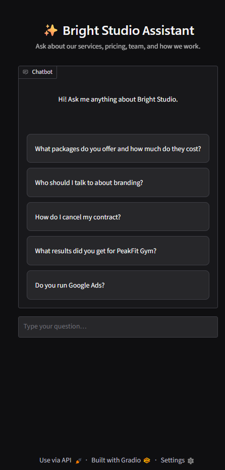
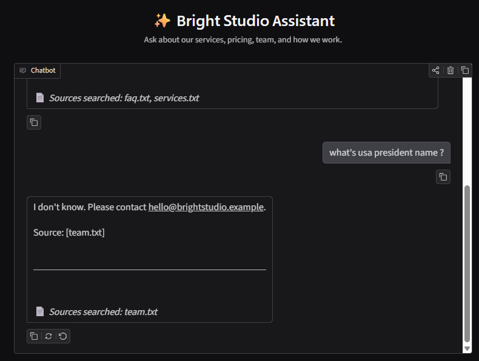
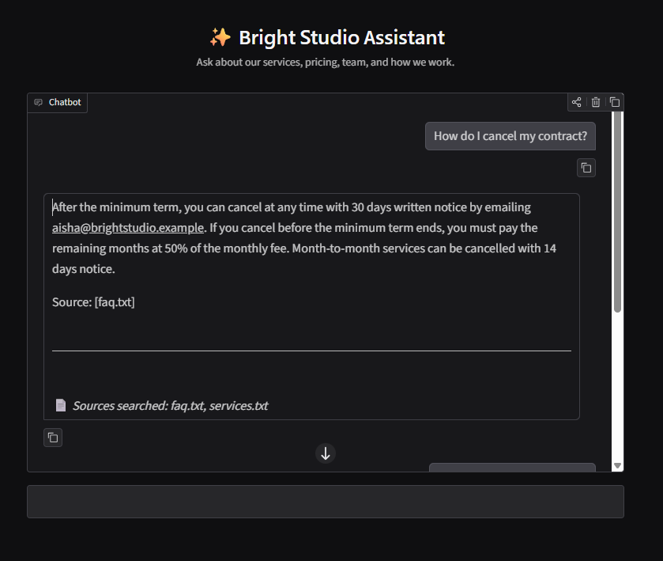

# Bright Studio Assistant
<p align="center">

<p align="center">

<p align="center">

</p>
A small, fully local RAG chatbot that answers questions about a fictional marketing agency, **Bright Studio**, using only the agency's own documents. Everything runs on your machine: Gemma (via Ollama) writes the answers, and ChromaDB stores the document index.

## How it works

```
Ingestion (once):  docs/*.txt -> split into chunks -> embed -> ChromaDB (db/)
Each question:     question -> embed -> top-5 similar chunks -> prompt -> Gemma -> answer + sources
```

| Part | Tool |
| --- | --- |
| LLM | `gemma4:12b` via Ollama |
| Embeddings | `all-MiniLM-L6-v2` (sentence-transformers) |
| Vector store | ChromaDB, persisted in `db/` |
| UI | Gradio chat |

## Project layout

```
agency-rag/
├── docs/            knowledge base (.txt): services, pricing, team, case studies, FAQ
├── ingest.py        builds the index into db/
├── ask.py           RAG core (retrieve + generate); also a CLI chat
├── app.py           web chat UI
├── requirements.txt
└── plan.md          original project plan
```

## Setup and run

Requirements: Python 3.10+, [Ollama](https://ollama.com) running, and the model pulled (`ollama pull gemma4:12b`).

```powershell
python -m venv venv
venv\Scripts\activate
pip install -r requirements.txt

python ingest.py      # build the index (re-run whenever docs/ changes)
python app.py         # open http://127.0.0.1:7860
```

CLI alternative: `python ask.py` (prints the retrieved chunks and their distances before each answer).

## Using your own documents

Replace the `.txt` files in `docs/`, then re-run `python ingest.py`. If you also change the system prompt in `ask.py` (it names Bright Studio), update it to match.

## Settings (top of `ask.py`)

| Setting | Meaning |
| --- | --- |
| `LLM_MODEL` | Ollama model tag; must match `ollama list` exactly |
| `TOP_K` | Number of chunks retrieved per question |
| `MAX_DISTANCE` | Chunks less similar than this are dropped, so off-topic questions get "I don't know" |
| `HISTORY_TURNS` | Previous exchanges included so follow-up questions work |

Chunk size and overlap are set at the top of `ingest.py`.
